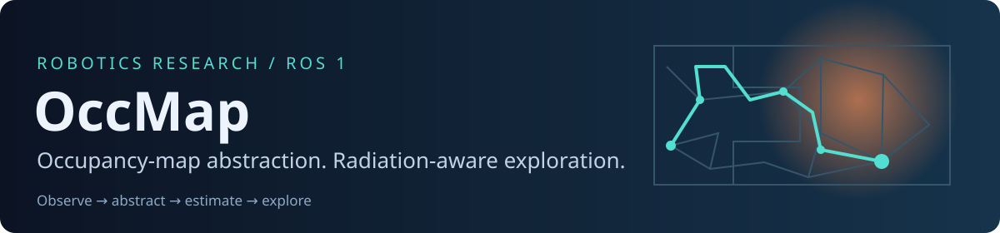
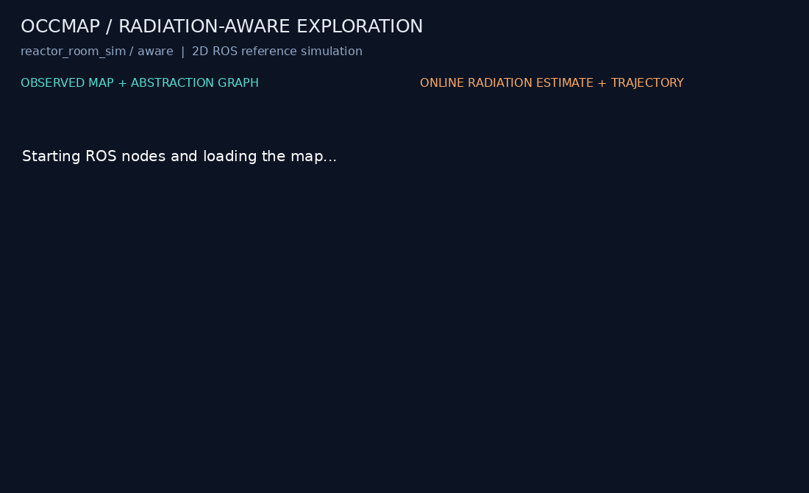
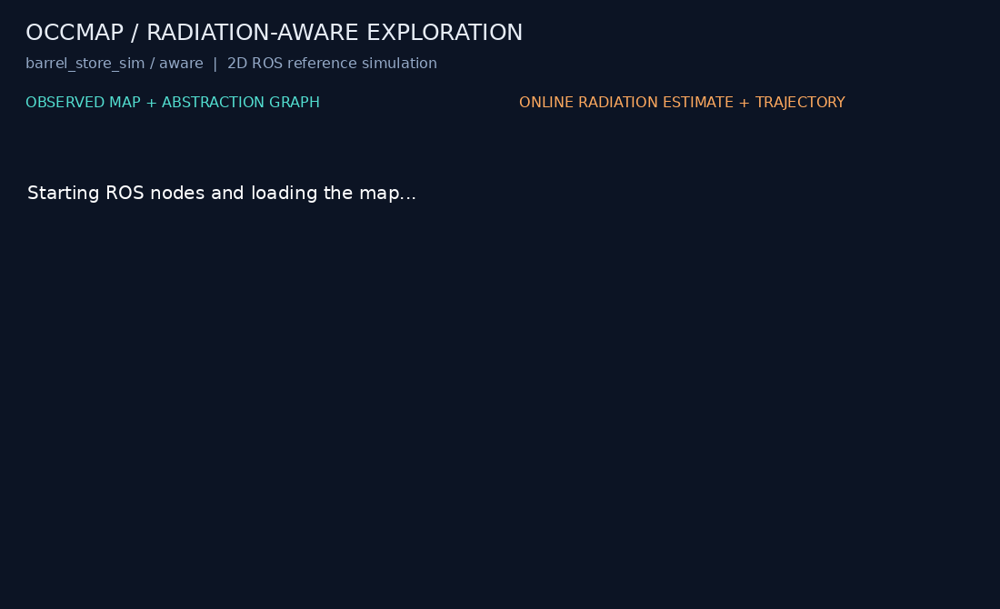
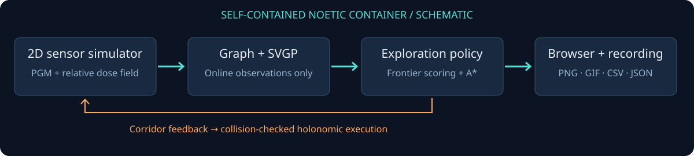

<div align="center">
  
  <p><strong>ROS Noetic · Occupancy-map abstraction · Frontier exploration · Online radiation estimation</strong></p>
  <a href="https://github.com/DavidBatty95/OccMapAbstractionROS1Pkg/actions/workflows/verification.yml">Verification workflow</a> ·
  <a href="docs/METHODOLOGY.md">Research methodology</a> ·
  <a href="docs/RESULTS.md">Recorded results</a> ·
  <a href="CITATION.cff">Cite this software</a>
</div>

**Explore an unknown map while accounting for an initially unknown radiation field.**
OccMap converts observed free space into a sparse navigation graph, scores
frontiers, estimates radiation online with a corridor-aware Gaussian process,
and plans exploration corridors using geometric and radiation costs.

Developed by **David Batty, University of Liverpool**, as part of PhD research into
autonomy in hazardous environments.

## Quick start — Docker + your browser

**GitHub-only recovery:** the previously separate research-demo branch has been
recovered and is being validated for the downloadable PhD demonstration.
[Recovery record](docs/RECOVERY.md) · [Guided demo and offline distribution](docs/DEMO_GUIDE.md).

The supported quick start is **x86-64 Linux with Docker Engine and Compose v2**.
No host ROS installation, GPU, Gazebo or display server is needed. Allow several
GB for the first image build and an internet connection for dependencies.

```bash
git clone https://github.com/DavidBatty95/OccMapAbstractionROS1Pkg.git
cd OccMapAbstractionROS1Pkg
bash occmap demo
```

Open **[http://localhost:8080](http://localhost:8080)**. The container builds the
installed catkin package, starts ROS, runs a two-minute exploration session, and
keeps the results page available afterward. Stop with **Ctrl+C**; artifacts remain
under `results/`. [Installation and troubleshooting](docs/INSTALLATION.md).

## See the method running

| Reactor-room exploration | Barrel-store exploration |
| --- | --- |
|  |  |

These are accelerated recordings of **the included ROS policy and estimator**
in the new 2D reference simulator. Left: observed map, abstraction graph and
planned corridor. Right: online radiation cost estimate and travelled path.
Blue is the trajectory; the green dot is the robot. Dark regions are unobserved.

**Scope:** the containerised 2D pipeline is runnable and tested. The simulator uses
idealised sensing and holonomic motion; these previews are not Gazebo recordings,
completed-mission results, or evidence of a statistically significant dose
reduction. Original Gazebo integration files are retained, with recovered pinned
upstreams in [`legacy.repos`](legacy.repos). [Compatibility status](docs/LEGACY.md).

## Run experiments

```bash
# Bounded headless run; exits nonzero if the pipeline checks fail:
bash scripts/demo.sh --duration 60 --check

# Another bundled environment:
bash scripts/demo.sh --map barrel_store_sim --duration 120 --seed 42 --check

# Radiation-unaware baseline, with exposure still measured by the simulator:
bash scripts/demo.sh --duration 120 --no-radiation --check

# Finer map resolution; more CPU work:
bash scripts/demo.sh --factor 2 --duration 120
```

Each run has its own directory containing:

| Artifact | Purpose |
| --- | --- |
| `live.png`, `demo.gif` | Last view and accelerated recording of ROS observations |
| `metrics.csv` | Simulation time, observed-free fraction, path length and relative exposure |
| `summary.json` | Final metrics, policy state and explicit pipeline-check outcome |
| `manifest.json` | Parameters, seed, package versions, source and map SHA-256 hashes |
| `ros.log` | Node startup, graph/estimator diagnostics and failures |

Five map/field pairs are bundled: `reactor_room_sim`, `barrel_store_sim`,
`base_env_sim`, `hut_interior`, and `hut_expanded`. All are checked for loading and
field consistency; end-to-end recorded examples are listed in [results](docs/RESULTS.md).

## Architecture



1. **Observe:** raycast an initially hidden map and sample radiation at the robot.
2. **Abstract:** build a sparse free-space graph with clearance and visibility checks.
3. **Estimate:** aggregate samples into voxels and fit a local sparse variational GP
   using spatial and geodesic-landmark features.
4. **Explore:** score frontier candidates and plan graph corridors with radiation costs.
5. **Record:** execute checked motion and export observations, metrics and provenance.

The planner never receives the ground-truth radiation array. The simulator uses
truth for sensing, collision checks and scoring. [Interfaces and assumptions](docs/METHODOLOGY.md).

## Performance and verification

The refresh replaces per-cell Python clearance scans with SciPy's exact Euclidean
distance transform, and legacy BFS inflation with a compiled Manhattan distance
transform. It also fixes repeated geodesic queue visits, GP feature conditioning,
local-fit fallback crashes and concurrent estimator state updates.

Raw before/after timings and metric differences are published in
[performance results](docs/PERFORMANCE.md). These are **kernel microbenchmarks**;
the clearance metric intentionally changes from approximate octile to Euclidean.

```bash
docker build -t occmap-research:noetic -f docker/Dockerfile .
docker run --rm occmap-research:noetic python3 -m pytest -q tests
```

CI builds the same image, runs numerical regression tests, and executes a headless
ROS smoke test. It retains recordings and logs even when a run fails.
[Local verification record](docs/VERIFICATION.md).

## Repository guide

```text
src/exploration_pkg/
  scripts/       ROS policy, estimator, simulators and legacy integration nodes
  python/occmap/ ROS-independent geometry and map loading
  launch/        Self-contained demo and original launch files
  config/        Documented reference-demo parameters
  maps/          Occupancy maps, source definitions and precomputed dose fields
docker/          Noetic image, Python requirements and entrypoint
scripts/         Run, benchmark and publish experiment artifacts
tests/           Numerical and ROS-node regression checks
docs/            Methodology, installation, recordings and performance evidence
archive/         Original external dependency revision record
```

## Research use and attribution

- [Methodology and limitations](docs/METHODOLOGY.md)
- [Recorded runs](docs/RESULTS.md) · [Performance measurements](docs/PERFORMANCE.md)
- [Legacy Gazebo restoration](docs/LEGACY.md)
- [Contributing](CONTRIBUTING.md) · [Changelog](CHANGELOG.md)

Radiation fields are in **relative dose-rate units**, not calibrated sieverts.
Published animations demonstrate pipeline behaviour; new scientific claims need
controlled comparisons across maps, seeds and matched stopping criteria.

Project code is licensed under [BSD-3-Clause](LICENSE). External dependencies keep
their own licences and attribution; see [third-party notes](docs/THIRD_PARTY.md).
Use [`CITATION.cff`](CITATION.cff) and include your exact commit and run manifest
when citing an experiment. Contact: [dwbatty@liverpool.ac.uk](mailto:dwbatty@liverpool.ac.uk).
