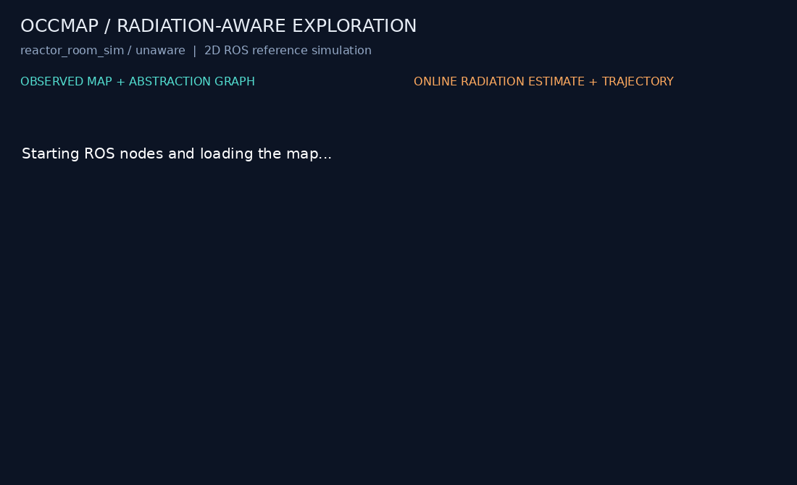

# Recorded reference runs

Generated from the retained summaries by `python3 scripts/refresh_results.py`.

These are bounded ROS integration demonstrations. All three runs used seed 42,
map factor 5 and a 120-second wall-clock recording. Full missions were not
completed. The paired reactor runs are descriptive examples, not a multi-seed
evaluation. Their simulated durations and achieved coverage differ.

| Run | Simulated time (s) | Observed free (%) | Path (m) | Exposure (relative-rate s) | Rejected motion | Pipeline check |
| --- | ---: | ---: | ---: | ---: | ---: | --- |
| [reactor](results/reactor/summary.json) | 119.2 | 63.70 | 69.68 | 88204.2 | 0 | pass |
| [barrel](results/barrel/summary.json) | 117.9 | 49.24 | 54.72 | 8353.2 | 0 | pass |
| [unaware](results/unaware/summary.json) | 118.5 | 69.53 | 65.22 | 9028.6 | 0 | pass |

In this recorded reactor pair, the aware policy accumulated **88204.2 relative-rate s**
against **9028.6** for the unaware baseline, with **63.70% vs 69.53%** observed-free coverage.
These outcomes are retained as measured; the demo is not evidence that radiation
awareness improves the exploration objective. Estimator calibration and policy
evaluation remain research work.

The unaware run disables the radiation estimator and radiation-based policy
penalties. The simulator still measures exposure. A lower exposure in one
recording does not establish general superiority; see [methodology](METHODOLOGY.md).

## Radiation-unaware baseline recording



The right panel has no estimate in this mode. The trajectory and dose integral
still come from the simulator. The other recordings are embedded in the
[README](../README.md). GIFs are accelerated; the image timestamp shows simulation time.

## Raw evidence

Each `docs/results/<run>/` directory contains `summary.json`, `manifest.json`,
`metrics.csv` and `ros.log`. Manifests record source/map hashes and dependency
versions; image/CSV hashes tie the published media to the run. These recorded
source hashes identify the implementation at capture time, even if documentation
or development tooling changes later.

Regenerate with the commands in [installation](INSTALLATION.md), then publish:

```bash
python3 scripts/publish_demo.py results/<recorded-run-directory> --name reactor
# Use --name barrel or --name unaware for the other cases.
python3 scripts/refresh_results.py
```

Failed development runs remain in the local ignored `results/` directory. CI
uploads diagnostics even on failure. The three published records are selected
pipeline demonstrations, not a complete experimental dataset.
